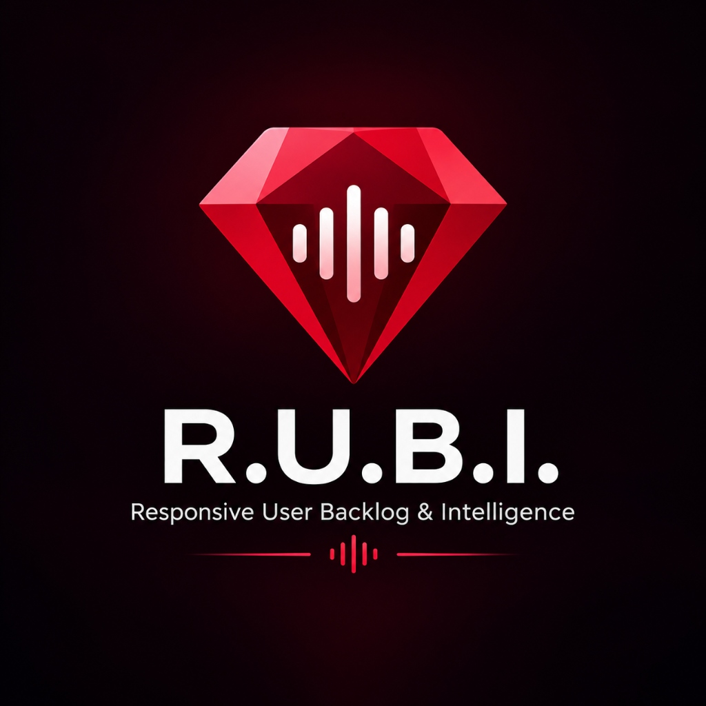
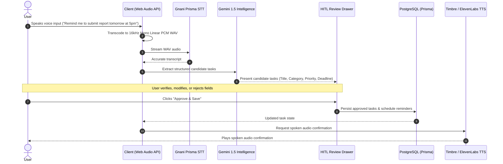
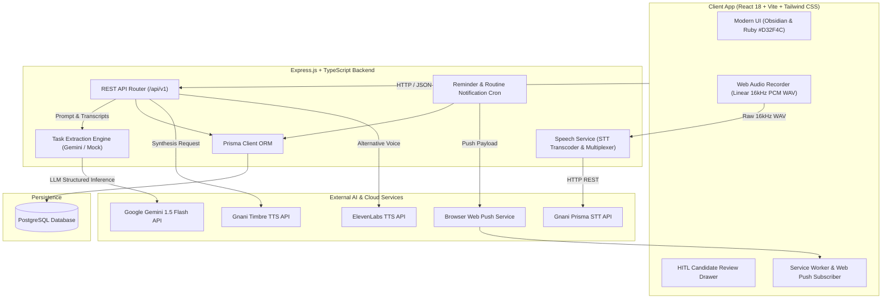

# R.U.B.I. 2.0 — Responsive User Backlog & Intelligence

<p align="center">
  
</p>

<p align="center">
  <strong>A Voice-First Personal Task Management Assistant</strong><br />
  <em>Capturing, structuring, and executing your daily priorities with Human-in-the-Loop AI.</em>
</p>

<p align="center">
  <a href="#features"></a>
  <a href="#license"></a>
  <a href="#operational-modes"></a>
  <a href="#tech-stack"></a>
</p>

---

## 1. Product Overview

**R.U.B.I. 2.0** (*Responsive User Backlog & Intelligence*) is an open-source, voice-first personal productivity system. It bridges the gap between chaotic, spoken thought and structured, disciplined execution.

Instead of navigating complex project management software or typing out task tickets manually, users speak or type naturally in English, Hindi, or Hinglish. R.U.B.I. transcribes the input, extracts actionable tasks, establishes sensible priorities and deadlines, structures recurring routines, and persists everything to PostgreSQL—always with **Human-in-the-Loop** verification before anything is saved.

---

## 2. The Problem It Solves

Traditional personal task apps suffer from two major friction points:
1. **High Capture Overhead:** Creating structured tasks with tags, deadlines, priority levels, and subtasks on a mobile device or desktop requires numerous clicks and keystrokes. As a result, critical tasks often remain captured as messy, unstructured notes or are forgotten entirely.
2. **AI Over-Automation & Hallucination:** Unconstrained autonomous agents frequently persist erroneous dates, misinterpret context, or invent dependencies without user confirmation.

**R.U.B.I. resolves this dichotomy:**
- You capture thought at the speed of speech.
- An intelligent parser extracts structured task candidates.
- You inspect and approve candidates before they touch your database.
- Scheduled routines and persistent reminders keep your daily workflow disciplined.

---

## 3. Three Core Pillars (Strict Scope)

R.U.B.I. 2.0 is deliberately scoped around three foundational modules:

```
+-------------------------------------------------------------------+
|                           R.U.B.I. 2.0                            |
+-------------------+-----------------------+-----------------------+
|     1. TASKS      |      2. ROUTINES      |     3. REMINDERS      |
+-------------------+-----------------------+-----------------------+
| * Voice/text add  | * Daily & weekly habits| * Persistent scheduled|
| * Categorization  | * Recurrence cadence  | * Sound & speech alert|
| * Priority/Effort | * Streak tracking     | * Web Push & in-app   |
| * Checklists      | * Voice routine add   | * Snooze & acknowledge|
| * Due dates & slot| * Completion logs     | * Task-linked alerts  |
+-------------------+-----------------------+-----------------------+
```

1. **Tasks:** Deep personal backlog with categories, priority matrices, subtasks/checklists, slot-based scheduling (morning/afternoon/evening), and status transitions.
2. **Routines:** Habit and recurring cadence tracker (daily, weekly) with voice-triggered creation, target frequencies, and persistent completion history.
3. **Reminders:** Dedicated reminder drawer and scheduled notifications supporting in-app drawer badges, browser audio chimes, synthesized speech announcements, and Web Push notifications.

---

## 4. Human-in-the-Loop Philosophy

> **"Silence Never Implies Consent."**

R.U.B.I. follows a strict zero-silent-write design philosophy. The AI never creates, updates, or deletes tasks without direct human authorization.



---

## 5. System Architecture



---

## 6. Visual Identity & Brand Assets

R.U.B.I. features an **Obsidian Dark** aesthetic (`#0c0c0e`, `#121214`, `#19191b`) paired with **Ruby Red** highlights (`#D32F4C` / `#EF4444`) and clean silver-white typography (`#F5F5F5`).

The brand mark is located at `apps/client/public/brand/rubi-mark.png` with complete SVG icons throughout the interface.

---

## 7. Technology Stack

- **Frontend:** React 18, TypeScript, Vite, Tailwind CSS, Lucide Icons, Radix UI primitives.
- **Backend:** Node.js, Express, TypeScript, Prisma ORM.
- **Database:** PostgreSQL.
- **Speech & AI:**
  - Speech-to-Text: **Gnani Prisma STT** (with built-in browser 16kHz linear PCM WAV transcoder).
  - Natural Language Extraction: **Google Gemini 1.5 Flash**.
  - Text-to-Speech: **Gnani Timbre TTS** and **ElevenLabs TTS**.
- **Testing & Tooling:** Vitest, Playwright, pnpm workspaces, TypeScript project references.

---

## 8. Repository Structure

```
rubi-2.0/
├── apps/
│   ├── client/                  # React 18 frontend (Vite, Tailwind, Web Audio)
│   │   ├── public/brand/        # Brand assets (rubi-mark.png, rubi-logo.jpg)
│   │   └── src/
│   │       ├── components/      # UI components, layout, and HITL modals
│   │       ├── hooks/           # useVoicePipeline, usePushNotifications
│   │       ├── lib/             # wavRecorder (PCM 16kHz), apiClient
│   │       └── views/           # TasksView, RoutinesView, RemindersView
│   └── server/                  # Express TypeScript backend
│       ├── prisma/              # schema.prisma, seed.ts, seed-demo.ts
│       └── src/
│           ├── routes/          # taskRoutes, routineRoutes, reminderRoutes, speechRoutes
│           └── services/        # speechService, taskService, reminderService
├── packages/
│   ├── mock-adapters/           # Deterministic mock STT, TTS, and LLM engines
│   └── shared/                  # Common TypeScript schemas, types, and DTOs
├── tests/                       # E2E test suites and fixtures
├── .env.example                 # Configuration template with full documentation
├── LICENSE                      # MIT License
└── pnpm-workspace.yaml          # Monorepo workspace configuration
```

---

## 9. Prerequisites

- **Node.js:** `>= 18.18.0` (Recommended: Node 20 LTS)
- **Package Manager:** `pnpm >= 8.0.0`
- **Database:** PostgreSQL `>= 14`
- **Browser:** Any modern Chromium, Firefox, or Safari browser with Web Audio API support.

---

## 10. Quickstart & Installation

### Step 1: Clone the repository
```bash
git clone https://github.com/durgvijay-builder/rubi-2.0.git
cd rubi-2.0
```

### Step 2: Install dependencies
```bash
pnpm install
```

### Step 3: Configure Environment Variables
Copy `.env.example` to `.env`:
```bash
cp .env.example .env
```
*(In Windows PowerShell: `Copy-Item .env.example .env`)*

Configure your database connection string and API keys in `.env`.

### Step 4: Setup Database & Seed Initial Data
```bash
# Push Prisma schema to your PostgreSQL database
pnpm --filter @rubi/server prisma db push

# (Optional) Seed demo tasks, routines, and default categories
pnpm --filter @rubi/server prisma db seed
```

### Step 5: Start Development Servers
```bash
# Runs both frontend (http://localhost:5173) and backend (http://localhost:3001) concurrently
pnpm dev
```

Open `http://localhost:5173` in your browser.

---

## 11. Operational Modes

R.U.B.I. supports three operating modes configured via `RUBI_MODE` in `.env`:

| Mode | Description | Requirements |
| :--- | :--- | :--- |
| **`mock`** *(Default)* | Completely offline. Uses fast deterministic simulation for STT, Gemini extraction, and TTS. | Zero API keys required. Perfect for development, testing, and UI work. |
| **`live`** | Requires valid API keys for Gnani, Gemini, and/or ElevenLabs. Fails gracefully if an external API is unavailable. | `GNANI_STT_API_KEY`, `GEMINI_API_KEY`, etc. |
| **`hybrid`** | Uses live providers when their keys are configured, falling back to mock adapters when unconfigured. | Configured keys run live; unconfigured run mock. |

---

## 12. Audio Pipeline & Technical Details

Many cloud STT providers reject compressed browser container formats (WebM/Opus) with errors like `UNSUPPORTED_AUDIO_FORMAT` or `AUDIO_CONVERSION_ERROR`.

R.U.B.I. solves this at the root:
- The client-side audio module (`apps/client/src/lib/wavRecorder.ts`) leverages the native browser `AudioContext` and an offline audio processing pipe.
- Audio is downsampled and transcoded directly in the browser to **16,000 Hz, 1-channel (mono), 16-bit linear PCM WAV**.
- Every audio blob uploaded over the wire begins with the canonical RIFF/WAVE header (`0x52 0x49 0x46 0x46 ... 0x57 0x41 0x56 0x45`), guaranteeing flawless compatibility with Gnani Prisma STT and other enterprise speech recognizers.

---

## 13. AI Providers & Voice Integration

### Google Gemini
Used for intent classification, entity extraction, due date normalization, and priority estimation:
```bash
GEMINI_API_KEY="your-gemini-api-key"
GEMINI_MODEL="gemini-1.5-flash"
```

### Gnani Prisma STT
Specialized multilingual speech recognition with deep Indian English, Hindi, and regional language support:
```bash
GNANI_STT_API_KEY="your-gnani-stt-key"
GNANI_STT_URL="https://asr.gnani.ai/api/v1/transcribe"
```

### Voice Output (TTS)
Choose between Gnani Timbre or ElevenLabs:
```bash
# Option A: Gnani Timbre
RUBI_TTS_PROVIDER="gnani"
GNANI_TTS_API_KEY="your-gnani-tts-key"
GNANI_TTS_URL="https://tts.gnani.ai/api/v1/synthesize"

# Option B: ElevenLabs
RUBI_TTS_PROVIDER="elevenlabs"
ELEVENLABS_API_KEY="your-elevenlabs-api-key"
ELEVENLABS_VOICE_ID="21m00Tcm4TlvDq8ikWAM"
```

---

## 14. Testing & Verification

R.U.B.I. includes an exhaustive test suite covering unit, integration, and end-to-end scenarios:

```bash
# Run unit and integration tests across all workspaces
pnpm test

# Run tests in watch mode
pnpm --filter @rubi/server test:watch

# Run TypeScript typechecks
pnpm --filter @rubi/client typecheck
pnpm --filter @rubi/server typecheck

# Run Playwright E2E tests
pnpm test:e2e
```

---

## 15. Security Disclosures & Limitations

Before deploying R.U.B.I. in multi-user production environments, review these architectural choices:

1. **Development Authentication:** The API currently utilizes workspace tenant routing based on `x-workspace-id` request headers and simulated user context for personal productivity workflows. It does not ship with a hardened public JWT / OAuth 2.0 multi-tenant auth flow out of the box.
2. **CORS:** The Express server defaults to permissive CORS for local development ports (`http://localhost:5173`, `http://localhost:3000`). Update CORS origin policies in `apps/server/src/index.ts` before internet deployment.
3. **Web Push (VAPID):** Push notification subscriptions are stored in the database. When deploying to production over the internet, HTTPS is mandatory for service worker push registration.

---

## 16. Contributing

Contributions are welcomed! To contribute:
1. Fork the repository.
2. Create your feature branch (`git checkout -b feature/amazing-feature`).
3. Commit your changes (`git commit -m 'feat: add amazing feature'`).
4. Push to the branch (`git push origin feature/amazing-feature`).
5. Open a Pull Request.

Please ensure tests pass (`pnpm test`) before submitting pull requests.

---

## 17. License

Distributed under the **MIT License**. See `LICENSE` for more information.

Copyright (c) 2026 **Durgvijay Chauhan**. All rights reserved.

